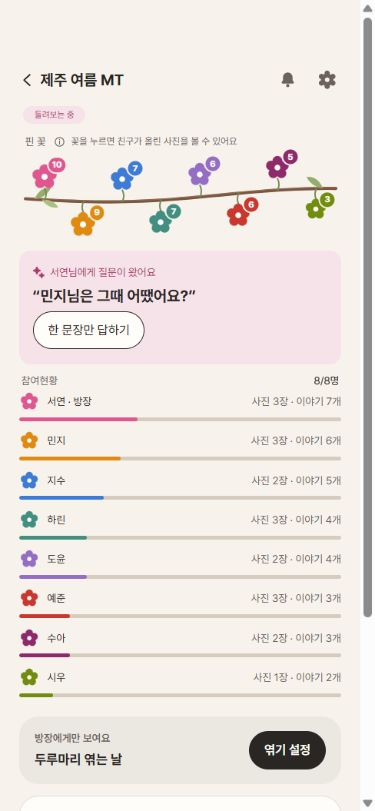
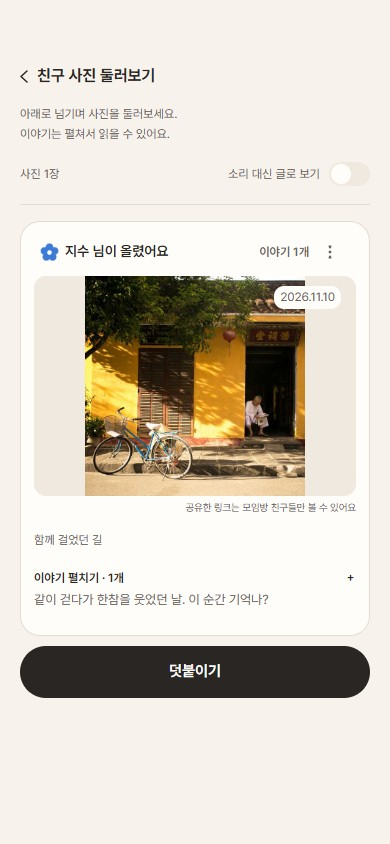
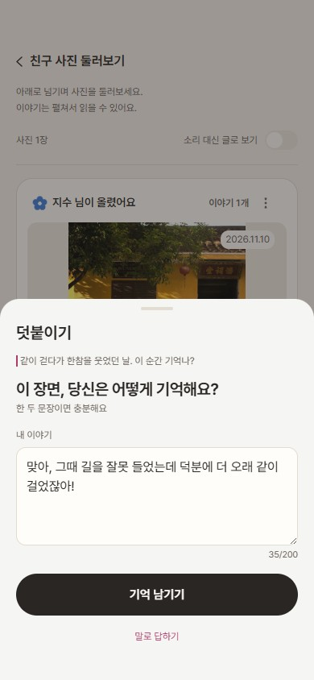
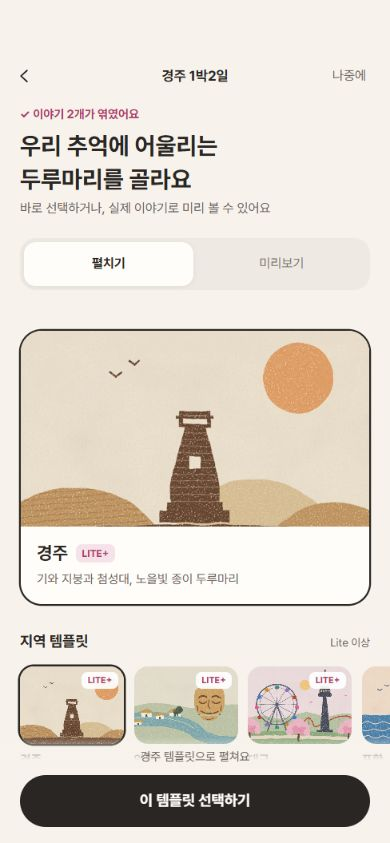
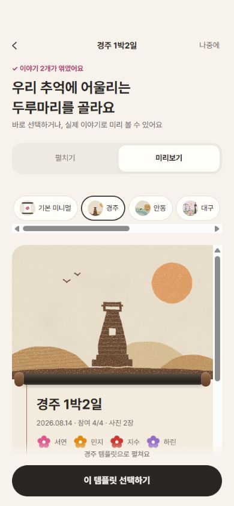
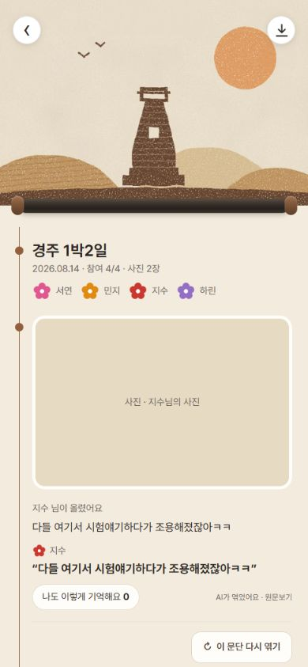
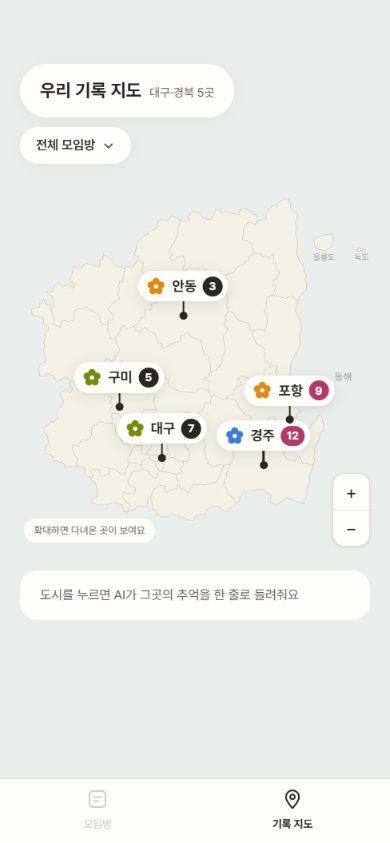
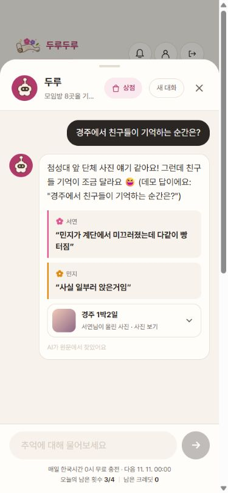
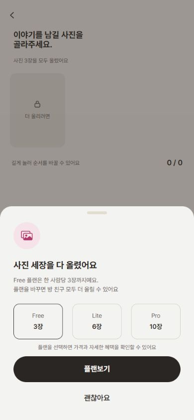
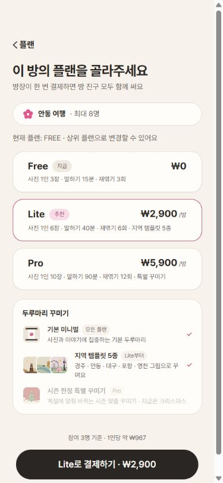

<div align="center">


# 두루두루

**사진 한 장, 한마디씩. 같이 다녀온 여행을 두루마리로 엮어요.**

사진에 각자의 이야기를 더하고, 함께 만든 기억을 지도와 두루마리로 다시 만나는 모바일 웹 서비스입니다.


[서비스 바로가기](https://43-201-73-60.sslip.io/) · [기능 둘러보기](#핵심-기능) · [로컬 실행](#실행-방법) · [API 연동 노트](./docs/api-audit-2026-11-09.md)

</div>

---

## 목차

1. [서비스 소개](#서비스-소개)
2. [핵심 기능](#핵심-기능)
3. [기술 스택](#기술-스택)
4. [실행 방법](#실행-방법)
5. [프로젝트 구조](#프로젝트-구조)
6. [아키텍처와 설계 결정](#아키텍처와-설계-결정)
7. [PWA와 배포](#pwa와-배포)
8. [협업과 문서](#협업과-문서)

## 서비스 소개

### 같은 사진, 서로 다른 기억

여행이 끝나면 사진은 남지만, **왜 그 순간 웃었는지, 누가 어떤 말을 했는지**는 사진만으로 떠올리기 어렵습니다. 같은 장면도 사람마다 다르게 기억합니다.

두루두루는 **함께 다녀온 사람들이 사진마다 한마디씩 보태는 기록**을 만듭니다. AI는 모인 이야기를 원문 인용과 함께 엮고, 여행이 끝난 뒤에는 장소와 질문으로 그 기억을 다시 찾아볼 수 있습니다.

| 모으기 | 돌려보기 | 엮기 | 다시 찾기 |
| :---: | :---: | :---: | :---: |
| 사진과 첫 한마디를 남겨요 | 친구의 사진에 이야기를 더해요 | 모인 기억이 두루마리가 돼요 | 지도와 두루에게 물어봐요 |

### 지역에서 함께한 경험을, 함께 남기는 기록으로

대구·경북의 여행 장소를 기록 지도에서 모아 보고, 경주·안동·대구·포항·영천의 지역 템플릿으로 두루마리를 꾸밀 수 있습니다. 장소는 사진을 분류하는 기준이면서, 나중에 기억을 찾아가는 단서가 됩니다.

## 핵심 기능

> 아래 이미지는 현재 프론트엔드를 실행해 **예시 데이터로 직접 캡처한 서비스 화면**입니다. [화면별 촬영 경로](./docs/readme/README.md)도 함께 정리했습니다.

### 01. 모으기 — 각자의 한마디가 모이는 모임방

초대 링크로 모임방에 함께 들어와 사진을 올리고, 사진마다 장소와 첫 한마디를 남깁니다. 말하기와 글쓰기를 모두 지원하며, 핀 꽃과 참여현황으로 친구들의 기록이 쌓이는 모습을 확인합니다.

<p align="center">
  
</p>

| 기능 | 동작 |
| --- | --- |
| 모임방 생성·초대 | 모임 이름, 날짜, 인원, 플랜을 정하고 링크로 친구를 초대합니다. 혼자 기록하는 1인방도 지원합니다. |
| 초대 링크 참여 | 모임방 목록의 ‘초대 링크로 참여’를 누르면 입력 모달이 열립니다. 받은 링크를 붙여넣어 초대받은 방에 참여합니다. |
| 사진·첫 한마디 | 사진의 장소를 고르고 음성 또는 글로 이야기를 남깁니다. |
| 핀 꽃·참여현황 | 사진과 이야기 수, 사람별 참여현황을 확인하고 친구의 기록으로 이동합니다. |
| 엮는 날 설정 | 날짜를 정해 기록을 모으거나, 방장이 지금까지 모인 기록으로 엮기를 시작합니다. |

### 02. 둘러보기 — 친구 사진에 내 기억을 더해요

친구들이 올린 사진을 둘러보고, 기억나는 이야기를 말이나 글로 덧붙입니다. 사진마다 이야기를 펼쳐 읽고, 소리를 듣기 어려울 때는 ‘소리 대신 글로 보기’로 확인합니다.

<table>
  <tr><th align="center">친구 사진 둘러보기</th><th align="center">이야기 덧붙이기</th></tr>
  <tr>
    <td align="center"></td>
    <td align="center"></td>
  </tr>
</table>

- 친구 사진은 **‘친구 사진 둘러보기’**, 내 사진은 모임방의 **핀 꽃**에서 확인합니다.
- **‘덧붙이기’**로 같은 순간에 대한 내 기억을 더합니다.
- 내 사진에는 **장소 추가·변경**을 제공하며, **⋯ 메뉴**에서 공유하거나 삭제할 수 있습니다.

### 03. 엮기 — 우리 이야기를 하나의 두루마리로

사진과 서로 다른 기억을 AI가 문단으로 엮습니다. 함께 남긴 원문을 확인하고, 빠진 이야기가 있으면 해당 문단을 다시 엮을 수 있습니다. 완성된 두루마리는 템플릿을 바꾸거나 이미지·PDF로 저장합니다.

<table>
  <tr><th align="center">템플릿 고르기</th><th align="center">이야기로 미리보기</th><th align="center">완성된 두루마리</th></tr>
  <tr>
    <td align="center"></td>
    <td align="center"></td>
    <td align="center"></td>
  </tr>
</table>

| 기능 | 동작 |
| --- | --- |
| 원문과 함께 읽기 | AI가 엮은 문장과 그 바탕이 된 친구들의 원문을 함께 봅니다. |
| 문단 다시 엮기 | 빠진 기억을 보태 문단을 다시 엮고 이전 문장과 달라진 부분을 확인합니다. |
| 엮기 전 확인 | 사진·첫 한마디가 엮은 뒤에는 수정할 수 없다는 안내와 남은 재엮기 횟수를 확인합니다. |
| 템플릿 | 기본 미니멀, 지역 템플릿 5종, 시즌 한정 특별 꾸미기를 플랜에 따라 사용합니다. |
| 저장·공유 | 이미지·사진별 카드·PDF를 준비하고 브라우저의 저장·공유 기능으로 내보냅니다. |

### 04. 다시 찾기 — 장소와 질문으로 꺼내 보는 추억

기록 지도에서 다녀온 도시와 장소를 누르거나, 두루에게 기억나는 단서를 물어봅니다. 두루의 답변에서는 관련 모임방·사진과 인용된 이야기를 확인할 수 있습니다.

그림 지도를 확대하면 장소별 꽃 핀이 나타나고, 더 확대하면 카카오맵으로 이어집니다. 장소 핀과 상세 화면의 지도 보기에서는 사진에 저장된 좌표로 해당 장소를 확인합니다.

<table>
  <tr><th align="center">우리 기록 지도</th><th align="center">두루에게 물어보기</th></tr>
  <tr>
    <td align="center"></td>
    <td align="center"></td>
  </tr>
</table>

### 모임방 플랜 — 가격과 혜택을 확인한 뒤 선택해요

한도 안내에서 방장이 Lite 또는 Pro를 고르면, **해당 플랜이 선택된 플랜 안내 화면**으로 이동합니다. 가격과 자세한 혜택을 확인한 뒤 결제 버튼으로 진행합니다. 멤버의 기존 방장 알림·변경 요청 흐름은 유지합니다.

<table>
  <tr><th align="center">한도 안내에서 플랜 선택</th><th align="center">가격·혜택 확인 후 결제</th></tr>
  <tr>
    <td align="center"></td>
    <td align="center"></td>
  </tr>
</table>

가격·사진 수·음성 시간·재엮기 한도는 서버의 플랜 카탈로그를 기준으로 표시합니다. LITE는 기본 꾸미기와 지역 템플릿, PRO는 시즌 한정 특별 꾸미기까지 사용할 수 있습니다.

결제 전에도 접혀 있는 **템플릿 미리보기**를 열어 꾸미기를 구경할 수 있습니다. 사진 한도에 도달하면 **‘더 올리기’**에서 한도를 확인하고, 엮기 전에 상위 플랜으로 바꾸면 늘어난 한도만큼 사진을 더 올릴 수 있습니다.

## 기술 스택

| 영역 | 사용 기술 |
| --- | --- |
| 화면 | React 19 · TypeScript 6 · Vite 8 |
| 스타일 | Tailwind CSS 4 · Pretendard · 공용 UI 컴포넌트 |
| 라우팅 | React Router |
| 서버 통신 | Fetch API · 쿠키 기반 인증 · CSRF · 멱등 요청 |
| 실시간 갱신 | EventSource / SSE · 연결 실패 시 주기적 조회 |
| 지도·공유 | 카카오 지도 JavaScript SDK · 카카오톡 공유 · Web Share API |
| 음성·초안 | MediaRecorder · IndexedDB · 로컬 초안 저장 |
| 내보내기 | html-to-image · jsPDF · fflate |
| 품질 관리 | ESLint · TypeScript 빌드 검사 · Node.js Test Runner |
| PWA·배포 | vite-plugin-pwa · GitHub Actions · Nginx |

## 실행 방법

### 설치와 실행

Node.js와 npm을 사용합니다. 저장소의 빌드 자동화는 Node.js 20 환경에서 실행됩니다.

```sh
git clone https://github.com/Dandimate-2026/dandimate-frontend.git
cd dandimate-frontend
npm ci
```

`.env.example`을 `.env.local`로 복사한 뒤 필요한 값만 설정합니다. 비워 둔 API 주소는 개발 서버에서 배포 백엔드로 프록시합니다.

```sh
npm run dev
```

### 환경 변수

| 변수 | 용도 |
| --- | --- |
| `VITE_API_BASE_URL` | 다른 백엔드를 연결할 때 지정합니다. 비우면 기본 배포 API를 사용합니다. |
| `VITE_USE_MOCK` | 개발 환경에서 `true`로 설정하면 예시 데이터와 방장·멤버 체험 로그인을 사용합니다. 기본값은 `false`입니다. |
| `VITE_KAKAO_JS_KEY` | 카카오톡 공유와 상세 지도 SDK용 JavaScript 키입니다. 카카오 콘솔에 접속 도메인을 등록해야 합니다. |
| `VITE_SITE_URL` | 친구에게 공유할 서비스의 기본 주소입니다. |
| `VITE_TOSS_CLIENT_KEY` | 백엔드와 같은 상점의 토스 **테스트 클라이언트 키**입니다. 키가 없으면 결제를 비활성화합니다. |
| `VITE_PAYMENT_DEMO` | 개발 환경의 결제 화면 시연용입니다. 배포 빌드에서는 적용되지 않습니다. |
| `VITE_VAPID_PUBLIC_KEY` | 서버에서 VAPID 공개키를 제공하지 않을 때 사용하는 웹 푸시 공개키입니다. |

예시 화면을 먼저 둘러보려면 아래 설정으로 개발 서버를 실행합니다. 모의 데이터 모드는 개발 환경에서만 활성화됩니다.

```dotenv
VITE_USE_MOCK=true
```

### 개발 명령어

| 명령어 | 설명 |
| --- | --- |
| `npm run dev` | 개발 서버 실행 |
| `npm run lint` | ESLint 검사 |
| `npm run build` | TypeScript 검사 후 배포용 파일 생성 |
| `npm run preview` | 빌드한 앱을 로컬에서 확인 |
| `node --test tests/*.test.cjs` | 동작·회귀 테스트 실행 |
| `npm run generate:pwa-assets` | 설치 아이콘 생성 |

## 프로젝트 구조

```text
src/
├── api/                  # 모임방·사진·결제·알림·AI 통신과 응답 타입
├── assets/               # 로고, 지도 그림, 지역·시즌 템플릿
├── components/           # 공용 버튼·카드·시트·지도·챗봇 UI
├── features/
│   └── memories/         # 돌려보기, 두루마리, 템플릿, 저장·재엮기
├── hooks/                # 플랜 한도, 초대 공유, 실시간 갱신 등
├── layout/               # 최대 430px 모바일 레이아웃
├── lib/                  # 인증, 초안, 결제 복구, 공유 등 공통 로직
├── pages/                # 경로별 화면
└── routes/               # 경로 정의와 로그인 진입 처리
public/                   # PWA 아이콘, 공유 이미지, 푸시 서비스 워커
tests/                    # 화면·탐색·결제·실시간 갱신 테스트
docs/                     # API 연동·검증 문서와 직접 캡처한 화면
```

## 아키텍처와 설계 결정

화면은 `api/`의 함수와 타입으로 서버와 통신합니다. 참여자·플랜·한도·결제 결과는 서버 응답을 사용하고, 작성 중인 사진과 글·음성 초안은 기기에 보관합니다.

| 설계 | 이유와 구현 |
| --- | --- |
| API 계층에 인증·요청 규칙 집중 | 쿠키 인증, 쓰기 요청의 CSRF 토큰, 공통 응답·오류 처리를 `api/client.ts`에서 관리합니다. |
| 서버가 결정하는 가격과 한도 | 플랜 카탈로그와 방의 사용량을 반영합니다. 프론트 안내만으로 결제·업그레이드 성공을 확정하지 않습니다. |
| 비동기 엮기 작업 | AI 작업의 진행·완료·실패 상태를 조회하고, 완료된 두루마리와 재엮기 결과를 불러옵니다. |
| 실시간 갱신과 복구 | 방별 SSE를 구독합니다. 연결이 끊기면 화면이 보이는 동안 주기적으로 조회하고 재연결합니다. |
| 작성 중인 내용 보존 | 사진·글·음성 초안을 기기에 보관해 화면을 오가거나 다시 열었을 때 이어 쓸 수 있게 합니다. |
| 결제 결과 재확인 | 복귀 시 주문 상태를 확인하고, 결과가 불확실하면 같은 주문을 다시 조회합니다. |
| 화면과 파일의 문서 컴포넌트 공유 | 두루마리 미리보기·내보내기에 같은 문서 컴포넌트를 사용해 템플릿과 내용이 일치하도록 합니다. |

## PWA와 배포

- 앱 이름은 **두루두루**이며 홈 화면에 설치할 수 있는 `standalone` PWA입니다.
- `vite-plugin-pwa`가 매니페스트와 서비스 워커를 생성합니다. 배포에는 `dist/` 전체를 사용합니다.
- 정적 앱 리소스와 글꼴을 캐시하며, API 응답은 서비스 워커에서 캐시하지 않습니다.
- 결제 복귀 경로는 최신 HTML을 받도록 캐시된 앱 화면으로 대체하지 않습니다.
- `feature/develop` 또는 `main`에 반영되면 GitHub Actions가 빌드 결과를 서버로 전송하고 Nginx 설정을 다시 읽습니다.

<details>
<summary><b>설치·아이콘·캐시 확인</b></summary>

개발 서버에서는 서비스 워커를 등록하지 않습니다. PWA 동작은 `npm run build` 후 `npm run preview`로 확인합니다. 배포에는 HTTPS가 필요하며 로컬에서는 `localhost` 또는 `127.0.0.1`을 사용할 수 있습니다.

지원 브라우저의 설치 메뉴를 이용하고, iOS에서는 공유 메뉴에서 **홈 화면에 추가**를 선택합니다. 설치 아이콘은 `public/favicon.svg`와 `pwa-assets.config.ts`를 기준으로 생성합니다.

새 서비스 워커는 실행 중인 화면을 강제로 새로고침하지 않고 활성화됩니다. 오프라인에서 앱 틀과 정적 리소스를 열 수 있지만, 서버 기록 조회와 새 요청에는 네트워크 연결이 필요합니다.

</details>

## 협업과 문서

작업 브랜치에서 변경을 기능 단위로 커밋하고 **`feature/develop` 대상 PR**로 검토합니다. 커밋은 `feat:`, `fix:`, `docs:`, `test:`, `chore:` 등의 접두사와 작업 설명을 사용합니다.

PR에는 변경 동작, 관련 화면, 검증 결과와 확인하지 못한 범위를 기록합니다. 코드 수정 후에는 `npm run lint`, `npm run build`와 변경 범위에 맞는 테스트를 확인합니다.

| 문서 | 내용 |
| --- | --- |
| [배포 API 연결](./docs/api-integration.md) | 개발·배포 API 연결과 확인 순서 |
| [API 연동 결과와 남은 계약](./docs/api-audit-2026-11-09.md) | 연동한 기능과 백엔드 계약 확인 사항 |
| [백엔드 전달 사항](./docs/api-backend-message-2026-11-09.md) | 서버 확인·추가 요청 정리 |
| [플랜·결제 검증](./docs/plan-payment-qa.md) | 주문·승인·완료·실패 화면과 검증 기록 |
| [README 화면 캡처](./docs/readme/README.md) | 소개 이미지의 화면 경로와 촬영 조건 |
