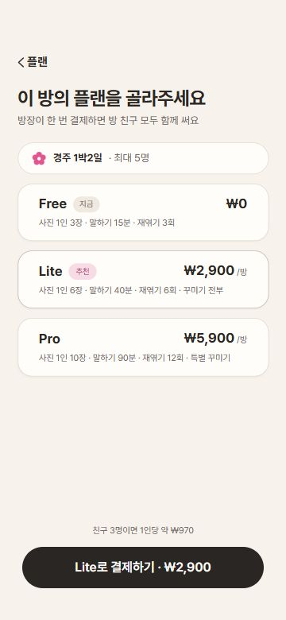
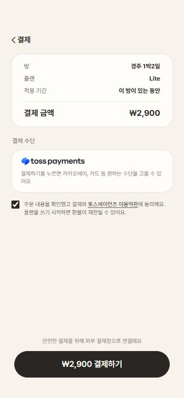
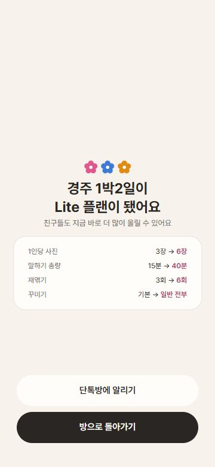
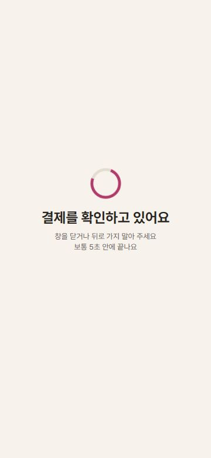
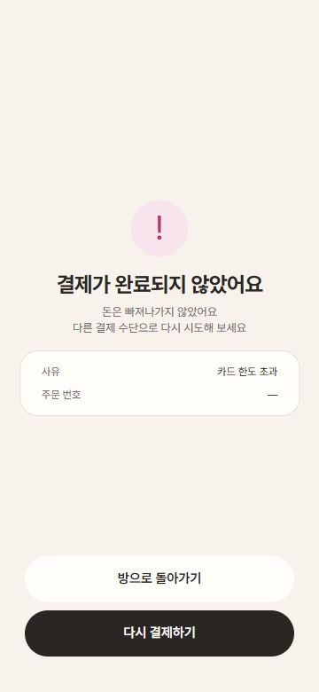

# 플랜·결제 화면 변경 및 검증

2026-11-06. 플랜 선택과 결제 화면은 사용자 첨부 시안, P-3 완료·P-4 확인 중·P-5 실패는 연결된 피그마 화면을 직접 확인해 반영했습니다. 피그마 연결 도구의 조회 한도로 브라우저에서 프레임을 확인했습니다.

## 화면

360×780에서 촬영했습니다. 기기 외곽선·상태 표시줄·홈 인디케이터는 웹 화면에 추가하지 않았습니다. 캡처에는 별도의 기능 미리보기 메뉴나 예시 데이터 안내를 표시하지 않습니다.

| 플랜 선택 | 결제 |
| --- | --- |
|  |  |

| P-3 완료 | P-4 확인 중 | P-5 실패 |
| --- | --- | --- |
|  |  |  |

## 변경 사항

- 플랜 카드·추천 배지·가격·설명·하단 결제 버튼을 첨부 시안에 맞췄습니다. 결제 화면에서 돌아와도 선택한 플랜을 유지합니다.
- 결제 화면은 주문 요약, 토스페이먼츠 안내, 동의 체크박스로 구성했습니다. 수단은 토스 카드·간편결제 통합창에서 선택합니다. 이용약관은 요청한 외부 링크로 열립니다.
- 완료 화면의 꽃 색상·한도 변경 강조와 실패 화면의 사유·주문 번호·버튼을 수정했습니다. 확인 중·실패 화면은 주문 요청과 실제 결제 복귀에서 공통 사용합니다.
- 새 방의 이름을 결제 복귀 후에도 보존하고, 완료 화면의 돌아가기 버튼은 방 홈으로 이동합니다.
- 결제 키 누락 시 자동 성공하던 분기를 제거했습니다. 시연은 개발 환경에서 명시적으로 켠 경우에만 동작합니다.
- 결제 결과를 확정하지 못하면 같은 주문을 다시 확인합니다. 이 경우 새 결제를 유도하거나 미출금을 단정하지 않습니다.
- 결제 복귀는 저장된 구버전 HTML을 사용하지 않습니다. 새 서비스 워커는 실행 중 화면을 새로고침하지 않고 활성화됩니다.

## 검증

- `npm run lint`, `npm run build` 통과.
- 320×640, 360×780, 430×932에서 가로 넘침 없음. 작은 화면에서 필요한 세로 스크롤과 하단 버튼 접근을 확인했습니다.
- 약관 동의 해제 시 결제 비활성화, 약관 링크 주소, Lite·Pro 선택과 결제 화면에서 돌아왔을 때 선택 유지 확인.
- 별도 로컬 API 응답을 사용한 배포용 빌드 검증: 승인 성공 → 완료 화면, PROCESSING 2회 후 DONE, PAYMENT_UNCERTAIN 4회 후 같은 주문 재확인 → DONE, 승인 실패 및 취소 → 사유·주문 번호 표시.
- 승인 요청 횟수는 성공 1회, 처리 중 3회, 불확실 결과 재확인 5회, 실패 1회로 확인했습니다.
- 구버전 서비스 워커가 결제 복귀를 이전의 없는 페이지로 반환하는 상황을 별도로 재현했습니다. 새 워커 활성화 후 새로고침하면 최신 결제 결과 화면으로 정상 복귀했습니다.
- 결제 키 없는 배포용 빌드에서는 결제 버튼 비활성화 확인. 실제 서비스의 결제나 승인 요청은 실행하지 않았습니다.

현재 배포 서버의 HTML과 JS에는 `/payments/success` 경로가 존재합니다. 사용자가 겪은 오류는 구버전 앱 캐시의 영향으로 추정되며, 사용자 기기의 기존 캐시 자체를 직접 확인한 것은 아닙니다. 서버 반영은 PR 머지·배포 후 확인해야 합니다.
