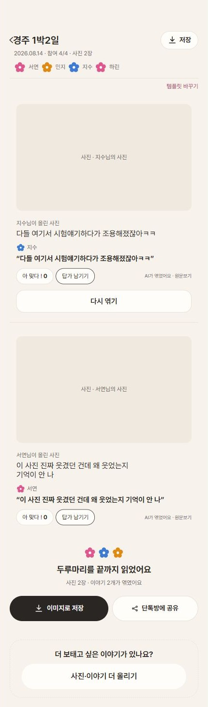
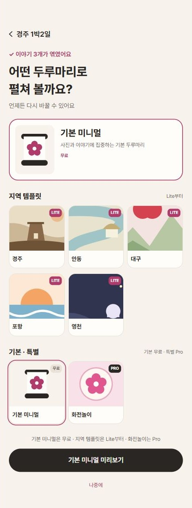
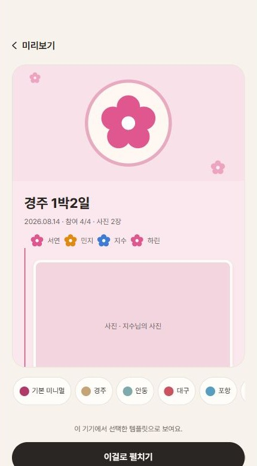
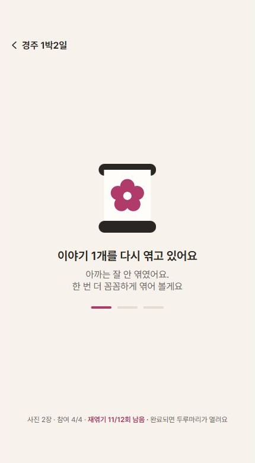
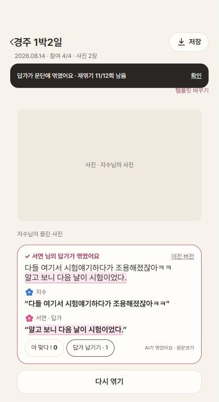
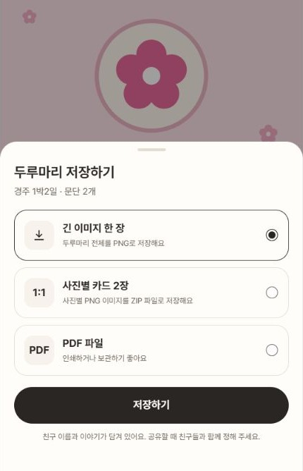
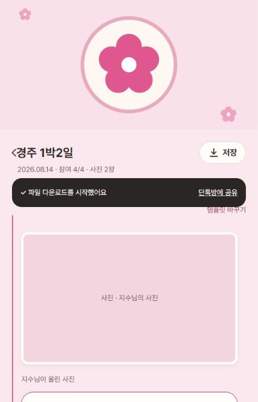

# 두루마리 평가·템플릿·다운로드·재엮기

2026-11-06 구현. Figma 댓글 #24의 최신 저장 시안, #25의 최신 `reweave.png`, #30의 템플릿 시안을 기준으로 했다. 댓글 첨부 시안 사용과 일러스트 도형의 코드 재현은 사용자가 승인했다.

## 구현한 동작

- 문단 평가가 서버에 저장된 뒤 평가 항목을 숨긴다. 실패하면 평가 항목을 유지한다. 방·참여자·문단·문단 버전별로 이 기기에 기록해 새로고침 후에도 유지한다. 문단 버전이 바뀌면 다시 평가할 수 있다.
- 1~2점으로 평가한 문단에만 **다시 엮기**를 보여준다. 기존 답가 입력 시트로 수정 설명을 보내고, 서버 작업이 `SUCCEEDED`가 된 뒤 두루마리를 다시 조회한다. `GROWING` 상태만으로 작업 완료를 판단하지 않는다. 진행 중에는 중복 엮기·다운로드를 막고, 실패하면 기존 두루마리와 오류를 보여준다.
- 완료 후 갱신된 문단을 표시하고 이 화면에서 이전 본문을 비교할 수 있다. 이전 버전 비교 데이터는 현재 화면에만 유지되며 서버의 버전 기록 API를 가정하지 않는다.
- 새 본문을 이전 본문과 비교해 추가·수정된 부분만 분홍색 형광펜 효과로 표시한다. 새 답가 원문에도 같은 효과를 표시한다. 삭제된 내용은 이전 버전에서 확인할 수 있다. 비교 표시는 해당 문단 버전과 현재 화면에 한정되며, 다운로드 파일에는 비교용 강조를 넣지 않는다.
- 재엮기 완료 토스트를 모임 정보 아래에 띄우고 서버의 남은 횟수·전체 한도를 표시한다. 확인 버튼 또는 4.5초 경과 시 닫힌다. 횟수가 응답에 없으면 임의로 만들지 않는다.
- 기본 미니멀, 경주, 안동, 대구, 포항, 영천, 화전놀이 템플릿 선택·미리보기를 제공한다. 서버의 `room.planType`에 따라 무료/Lite/Pro 사용 범위를 적용한다. 플랜이 없으면 무료 범위만 허용한다. 결제 흐름은 변경하지 않았다.
- 템플릿은 사용자 승인에 따라 기기별로 저장한다. 방장이 선택한 템플릿을 전체 참여자에게 동기화하는 기능은 서버 API가 없어 구현하지 않았다.
- 실제 두루마리의 제목·날짜·참여자·사진·문단·원문을 긴 PNG, 사진별 정사각형 PNG 묶음 ZIP, 사진별 페이지 PDF로 내려받는다. 화면의 버튼·평가·입력 폼은 포함하지 않는다. 외부 사진을 읽을 수 없으면 빈 사진으로 저장 성공 처리하지 않고 오류를 표시한다. 브라우저는 앨범 저장 완료 여부를 알 수 없어 ‘파일 다운로드를 시작했어요’로 안내한다.
- 상단 제목 옆 저장 버튼과 하단 저장·공유 버튼을 제공한다. 저장 완료 토스트의 공유 버튼은 Web Share에서 파일 공유가 가능하면 생성한 파일을 공유하고, 그 외에는 방 링크 공유 또는 복사로 이어진다. 실제 외부 채팅방으로 메시지를 전송하는 검증은 하지 않았다.

## 실제 API 연결

Swagger UI가 참조하는 `/openapi/public-api.yaml`을 확인했다.

| 동작 | API |
| --- | --- |
| 두루마리 조회 | `GET /api/v1/rooms/{roomId}/scroll` |
| 평가 저장 | `PUT /api/v1/paragraphs/{paragraphId}/fidelity-rating` / `{ score: 1..5 }` |
| 평가 후 재엮기 | `POST /api/v1/paragraphs/{paragraphId}/replies` / `{ inputMode, transcript, transcriptionId? }` |
| 진행 상태 | `GET /api/v1/jobs/{jobId}` |
| 음성 입력 | `POST /api/v1/paragraphs/{paragraphId}/transcriptions` |
| 실패한 전체 엮기 복구 | `POST /api/v1/rooms/{roomId}/weave-jobs` / 방장 전용, 평가 후 재엮기와 구분 |

최신 계약에 맞춰 요청에 로그인 쿠키(`credentials: include`)와 쓰기 요청의 CSRF 헤더를 포함한다. CSRF 토큰은 `GET /auth/csrf`로 발급받고 동시 요청에서 중복 조회하지 않는다. 답가 생성 및 음성 받아쓰기에 `Idempotency-Key`를 보낸다. 기존 방별 토큰 호출부는 호환성을 위해 유지하되, 두루마리 화면은 로컬 토큰이 없어도 서버 로그인 쿠키로 조회할 수 있다.

`ScrollResponse`에는 현재 사용자의 평가를 다시 읽는 필드가 없다. 따라서 평가 숨김과 재엮기 버튼 표시의 복원은 이 기기에 한정된다. 다른 기기에서도 복원하려면 서버 응답 필드가 필요하다. 템플릿과 파일 출력은 별도 API를 임의로 만들지 않고 클라이언트에서 처리한다.

## 확인 방법

기존 `/rooms/{roomId}/weaving` 화면에 반영했다. `VITE_USE_MOCK=true` 개발 서버의 `/rooms/scroll-review/weaving`은 예시 데이터임을 상단에 표시하고 API 쓰기 없이 기능을 확인할 수 있다. 실제 배포 빌드에서는 예시 모드가 활성화되지 않는다.

PR용 캡처는 같은 개발 화면에 `?capture=1`을 붙여 상단의 ‘기능 미리보기 · 예시 데이터’ 안내만 제외했다. 작업 시작·완료 시에도 이 옵션을 유지한다. 아래 캡처는 모두 예시 데이터이며 실제 서버 저장을 입증하지 않는다.

| 평가 완료 | 템플릿 선택 | 템플릿 미리보기 |
| --- | --- | --- |
|  |  |  |

| 재엮기 대기 | 변경 부분 강조 | 저장 형식 | 다운로드 완료 |
| --- | --- | --- | --- |
|  |  |  |  |

1. 두 문단을 각각 2점·5점으로 평가한다. 평가 항목은 둘 다 숨고, 2점 문단에만 다시 엮기가 나타나야 한다. 새로고침 후 유지되는지 확인한다.
2. 다시 엮기에서 글을 입력하고 제출한다. 대기 → 완료 → 이전 버전 비교를 확인한다. 새 문단 버전에서는 평가할 수 있어야 한다.
3. 템플릿을 골라 미리보기 후 적용한다. 새로고침 후 선택이 유지되는지 확인한다.
4. 상단 저장 또는 하단 이미지로 저장에서 PNG·ZIP·PDF를 각각 내려받는다.

## 검증과 제한

- 브라우저에서 평가 숨김, 1~2점 조건, 새로고침 복원, 수정 설명 입력, 작업 대기/완료, 이전 본문 보기, 템플릿 선택·적용을 확인했다.
- 추가 수정 후 실제 화면에서 변경된 문장과 새 답가만 강조되는 것을 확인했다. 남은 횟수가 감소한 재엮기 완료 토스트와, 공유 버튼을 가진 다운로드 완료 토스트도 확인했다. 한국어 추가·치환·복수 수정·이모지·삭제·빈 원문·긴 원문 비교 7개 사례를 검사했다.
- PNG를 실제 내려받아 한글과 템플릿·본문 렌더링을 확인했다. ZIP 안의 PNG 수와 정사각형 크기, PDF 페이지 수도 확인했다.
- 320/360/430px 화면에서 가로 넘침이 없고, 320px 저장 시트가 화면 안에 들어오는 것을 확인했다.
- API 요청 계약 검사에서 평가/답가 본문, 쿠키, CSRF 중복 방지, 멱등성 키, 오류 전달을 확인했다. 실제 서버의 CSRF 토큰 발급은 200 응답이었다.
- 실제 서버에 카카오 로그인 후 제공받은 방을 확인했다. 방은 아직 `CIRCULATING` 상태로 두루마리가 없어 실제 평가·답가 쓰기 검증은 진행하지 않았다. 방의 진행 상태나 콘텐츠를 변경하지 않았다.
- 서버는 로컬 출처의 직접 API 호출에 403을 반환한다. 다른 출처에 배포한다면 CORS/쿠키 정책 또는 같은 출처 프록시를 확인해야 한다. 이번 작업은 기존 로그인·방 생성 전체를 최신 API로 이관하는 작업을 포함하지 않는다.

## 최신 개발 브랜치와 통합

- `origin/feature/develop`의 `b26746c`를 작업 브랜치에 병합했다. 개발 브랜치 자체에는 커밋하거나 푸시하지 않았다.
- 로그인 쿠키·CSRF 갱신·개발 프록시는 개발 브랜치의 API 클라이언트를 그대로 사용한다. 결제 SDK, 전체 플랜·한도 타입, 역할별 데모 방과 기존 방 ID를 유지했다.
- 답가 녹음은 개발 브랜치의 `maxVoiceMs`/`voiceMaxMs`를 사용한다. 음성·재엮기 한도 시트와 플랜 이동을 유지하면서 이번 대기 화면·완료 토스트·본문 비교를 연결했다.
- 새 재엮기 예시 데이터는 `scroll-review`에 한정해 기존 한도 소진 예시 방에 영향을 주지 않는다.
- 병합 후 2점·5점 평가 숨김, 1~2점 재엮기 조건, 작업 대기·완료·강조, 새 버전 재평가를 브라우저에서 다시 확인했다. 기존 방의 20초 녹음 안내와 재엮기 3/3회 한도 시트도 확인했다.
